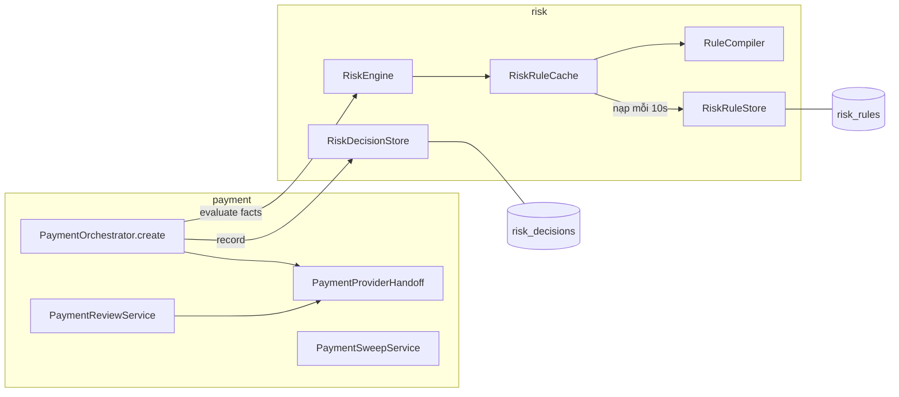
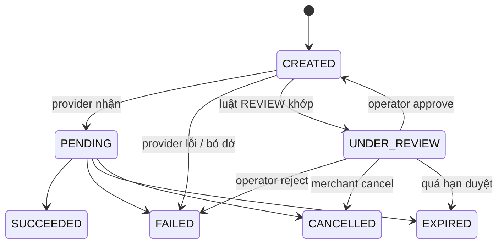

# Risk rule engine — Thiết kế, hướng dẫn sử dụng và cấu hình

> Tài liệu tham chiếu cho rule engine của gateway (increment 3a, build 2026-11-26, migration V9–V12).
> Gồm ba phần: [A. Thiết kế](#a-thiết-kế), [B. Hướng dẫn sử dụng](#b-hướng-dẫn-sử-dụng), [C. Cấu hình](#c-cấu-hình).
>
> Tài liệu này mô tả **hệ thống đang chạy như thế nào**. Phần "vì sao lại thiết kế vậy, bản sai trông ra sao" nằm ở các learning note `docs/learning/10` → `13`.

## Tóm tắt một phút

- Trước khi tạo payment, gateway hỏi một danh sách **luật** lưu trong bảng `risk_rules`. Luật là dữ liệu: đổi luật bằng SQL, không build, không deploy, không restart.
- Mỗi luật có một **condition** (cây JSON trên năm **fact** của request) và một **action**:
  - `REJECT` → trả `422 RISK_REJECTED`, không tạo payment, không gọi provider.
  - `REVIEW` → tạo payment ở trạng thái `UNDER_REVIEW`, không gọi provider, chờ **operator** duyệt hoặc từ chối.
  - Không luật nào khớp → cho qua (`ALLOW`), luồng tạo payment như cũ.
- Luật được xét theo `(priority, id)` tăng dần; **luật khớp đầu tiên quyết định**.
- Luật được cache trong bộ nhớ, nạp lại mỗi 10 giây. Mỗi lần đánh giá ghi một dòng vào `risk_decisions`.
- Operator làm việc qua `/internal/reviews`, xác thực bằng header `X-Admin-Token`.

---

# A. Thiết kế

## A1. Phạm vi

| Có | Không có (cố ý) |
|---|---|
| Luật trong database, evaluator tự viết | Thư viện rule engine (Drools), ngôn ngữ biểu thức (SpEL) |
| Fact tính được ngay từ request | Fact có state: velocity ("5 payment/phút"), lịch sử khách hàng |
| Action `REJECT`, `REVIEW` | Chấm điểm rủi ro, luật routing, luật phí |
| Đổi luật bằng SQL | API/UI quản lý luật, lịch sử phiên bản luật |
| Audit mỗi lần đánh giá | Job dọn/retention cho bảng audit |
| Operator duyệt bằng shared token | Tài khoản/role của operator, báo kết quả về merchant |

## A2. Thành phần



Package `com.fluxpay.gateway.risk` **không import gì từ `payment`**; chỉ `payment` gọi vào `risk`.

| Lớp | Package | Vai trò |
|---|---|---|
| `RiskFacts` | risk | Record năm fact. `FIELD_TYPES` là whitelist của ngôn ngữ luật; `asMap()` là dạng luật nhìn thấy và cũng là dạng được ghi vào audit. |
| `RuleCompiler` | risk | JSON condition → cây `Condition`. **Mọi** kiểm tra ngữ pháp nằm ở đây; sai thì ném `InvalidRuleException`. |
| `Condition` | risk | `All` / `Any` / `Leaf`. `test(facts)` thuần: không I/O, không state. |
| `CompiledRule` | risk | Một luật đã compile: `id, merchantId, priority, condition, outcome, reasonCode`. |
| `RiskRuleStore` | risk | Đọc `risk_rules` (`enabled`, sắp theo `priority, id`). |
| `RiskRuleCache` | risk | Danh sách `CompiledRule` bất biến trong bộ nhớ; nạp lúc khởi động và theo lịch. |
| `RiskEngine` | risk | `evaluate(facts)` → `RiskDecision(outcome, ruleId, reasonCode)`. Chỉ đọc cache. |
| `RiskDecisionStore` | risk | Ghi một dòng `risk_decisions`. |
| `RiskRejectedException` | risk | Ném khi `REJECT`; được map thành 422. |
| `PaymentOrchestrator` | payment | Gọi engine trong `create()`, xử lý ba nhánh ALLOW / REJECT / REVIEW. |
| `PaymentReviewService` | payment | `listUnderReview`, `approve`, `reject` cho operator. |
| `PaymentProviderHandoff` | payment | Gọi provider + `CREATED → PENDING` + compensate; dùng chung cho create và approve. |
| `PaymentSweepService` | payment | Hết hạn `PENDING` / `UNDER_REVIEW`; dọn `CREATED` bị bỏ dở. |
| `PaymentReviewController` | payment | `/internal/reviews`. |
| `AdminTokenFilter` (+`Config`) | common | Bảo vệ `/internal/*`. |

## A3. Luồng tạo payment

```
POST /api/v1/payments
  MerchantAuthFilter (HMAC)  →  IdempotencyFilter (key)  →  PaymentController
  PaymentOrchestrator.create():
    1. resolve provider (code lạ → 400, chưa ghi gì)
    2. facts = RiskFacts(amount, provider, merchantId, orderId, hourOfDay)
    3. decision = RiskEngine.evaluate(facts)          ← chỉ đọc bộ nhớ
    4. theo decision:

  REJECT  insert risk_decisions (payment_id = null)   ← một câu, tự commit
          → 422 RISK_REJECTED                           không có payment, không gọi provider

  REVIEW  MỘT transaction {
            insert payments (CREATED, expires_at = now + review-timeout)
            CREATED → UNDER_REVIEW   (reason = reason_code của luật, source SYSTEM)
            insert risk_decisions (REVIEW, payment_id) }
          → 201 { status: "UNDER_REVIEW", payUrl: null }  không gọi provider

  ALLOW   tx1 { insert payments (CREATED, expires_at = now + payment.expiry)
                insert risk_decisions (ALLOW, payment_id) }
          provider.createPayment(...)                   ← không có transaction
          tx2 { provider_ref, pay_url; CREATED → PENDING }
          → 201 { status: "PENDING", payUrl: "..." }
```

Điểm cần nhớ:

- Engine chạy **trước** mọi lần ghi, và trước kiểm tra trùng order.
- Dòng audit `ALLOW`/`REVIEW` nằm **cùng transaction** với dòng payment: đơn trùng (`409 ORDER_ALREADY_EXISTS`) rollback cả hai.
- `IdempotencyFilter` lưu cả `201` lẫn `422`. Gửi lại cùng `Idempotency-Key` → replay response cũ, **không đánh giá lại luật**, không thêm dòng audit.

## A4. Mô hình dữ liệu

### `risk_rules` (V9, action mở rộng ở V12)

| Cột | Kiểu | Ý nghĩa |
|---|---|---|
| `id` | `BIGINT` identity | Khóa; cũng là tiêu chí phụ khi hai luật cùng `priority`. |
| `name` | `VARCHAR(100)` | Tên để người đọc; engine không dùng. Không unique. |
| `merchant_id` | `UUID`, null được | `NULL` = áp dụng cho mọi merchant. Không có foreign key. |
| `priority` | `INT` | Số **nhỏ** được xét **trước**. |
| `condition` | `JSONB` | Cây điều kiện (mục A5). |
| `action` | `VARCHAR(20)` | `REJECT` hoặc `REVIEW` (CHECK constraint). |
| `reason_code` | `VARCHAR(40)` | Token ổn định trả cho merchant / ghi vào ledger. |
| `enabled` | `BOOLEAN`, mặc định `true` | `false` = luật bị bỏ qua hoàn toàn. |
| `created_at`, `updated_at` | `TIMESTAMPTZ` | Mặc định `now()`. `updated_at` **không tự cập nhật** khi `UPDATE`. |

Index: `ix_risk_rules_enabled_priority (enabled, priority)`.

Luật seed:

| name | priority | condition | action | reason_code |
|---|---|---|---|---|
| `global-amount-limit` | 100 | `amount > 50000000` | `REJECT` | `AMOUNT_OVER_LIMIT` |
| `global-review-high-amount` | 200 | `amount > 20000000` | `REVIEW` | `HIGH_AMOUNT` |

Hệ quả: ≤ 20.000.000 đi thẳng; trên 20.000.000 đến 50.000.000 bị giữ; trên 50.000.000 bị từ chối.

### `risk_decisions` (V10, chỉ thêm, không sửa)

| Cột | Ý nghĩa |
|---|---|
| `id` | `BIGINT` identity. |
| `merchant_id`, `order_id` | Request nào. |
| `payment_id` | Có với `ALLOW` / `REVIEW`; `NULL` với `REJECT`. Không foreign key. |
| `decision` | `ALLOW`, `REJECT`, `REVIEW`. |
| `matched_rule_id` | Luật đã khớp; `NULL` với `ALLOW`. **Không foreign key**: xóa luật không mất lịch sử. |
| `reason_code` | `reason_code` của luật khớp; `NULL` với `ALLOW`. |
| `facts` | `JSONB`: đúng năm fact luật đã thấy. Không bao giờ chứa header, chữ ký, secret. |
| `created_at` | Thời điểm đánh giá (đồng hồ ứng dụng). |

Index: `(payment_id)`, `(merchant_id, created_at)`.

### Thay đổi ở bảng có sẵn

- `payments.status` có giá trị mới `UNDER_REVIEW`.
- `ux_payments_live_order` (V11): `WHERE status IN ('CREATED', 'UNDER_REVIEW', 'PENDING', 'SUCCEEDED')`.
- `payment_transitions.source` có giá trị mới `OPERATOR`.

## A5. Ngôn ngữ luật

### Ngữ pháp

```
node := {"all":[node, ...]}      mọi con đều đúng
      | {"any":[node, ...]}      ít nhất một con đúng
      | leaf
leaf := {"field": <tên>, "op": <toán tử>, "value": <giá trị>}
```

### Fact (field)

| Field | Kiểu | Giá trị |
|---|---|---|
| `amount` | số | Số tiền của request (VND, số nguyên). |
| `hourOfDay` | số | Giờ hiện tại 0–23, theo `fluxpay.risk.zone`. |
| `provider` | chuỗi | Mã provider **sau khi resolve** (request không gửi thì là provider mặc định, ví dụ `MOCK`). Phân biệt hoa thường. |
| `merchantId` | chuỗi | UUID của merchant, dạng **chữ thường** (`00000000-0000-0000-0000-000000000001`). |
| `orderId` | chuỗi | `orderId` của request. |

### Toán tử

| `op` | Nghĩa | Field số | Field chuỗi | `value` |
|---|---|---|---|---|
| `eq` | bằng | ✓ | ✓ | một giá trị |
| `ne` | khác | ✓ | ✓ | một giá trị |
| `gt` `gte` `lt` `lte` | `>` `>=` `<` `<=` | ✓ | ✗ | một số |
| `in` | thuộc tập | ✓ | ✓ | mảng khác rỗng |

### Luật bị từ chối khi compile

| Lỗi | Thông điệp trong log |
|---|---|
| Không phải JSON object (`"amount > 5"`, `42`, `[]`) | `a condition must be a JSON object` |
| Thừa/thiếu key; trộn `all` với `any`; key lạ (`not`) | `a condition must have exactly the key "all", the key "any", or the keys field/op/value` |
| `all` / `any` rỗng hoặc không phải mảng | `"all" must be a non-empty array` |
| Lồng sâu quá 5 tầng | `condition is nested deeper than 5 levels` |
| Field không có trong bảng trên | `unknown field "..."` |
| Toán tử lạ, hoặc viết hoa (`GT`) | `unknown operator "..."` |
| `gt/gte/lt/lte` trên field chuỗi | `operator "gt" needs a number field, "provider" is text` |
| Field số mà `value` không phải số nguyên JSON (`"50000000"`, `5e7`, `50000000.0`, `1.5`, quá `long`) | `field "amount" needs a whole-number value` |
| Field chuỗi mà `value` không phải chuỗi | `field "provider" needs a string value` |
| `in` không kèm mảng khác rỗng | `operator "in" needs a non-empty array value` |
| `action` không phải `REJECT`/`REVIEW` (chỉ xảy ra nếu bỏ CHECK) | `unknown action "..."` |

Không có ép kiểu ngầm ở bất cứ đâu.

## A6. Thứ tự xét và phạm vi

1. Lấy các luật `enabled = true`, sắp theo `priority` tăng dần, rồi `id` tăng dần.
2. Bỏ qua luật có `merchant_id` khác merchant của request.
3. Luật đầu tiên có condition đúng → trả `(action, id, reason_code)` và **dừng**.
4. Hết danh sách → `ALLOW`.

Luật riêng của merchant **không tự động thắng** luật chung: nó thắng khi có số `priority` nhỏ hơn.

## A7. Cache và nạp lại

- `RiskRuleCache` giữ một `List<CompiledRule>` **bất biến** sau một tham chiếu `volatile`. Nạp lại = dựng xong danh sách mới rồi gán tham chiếu. Request thấy hoặc toàn bộ luật cũ, hoặc toàn bộ luật mới.
- Nạp lần đầu trước khi web server nhận request. Sau đó `@Scheduled(fixedDelay = fluxpay.risk.refresh-interval)`.
- Log: `Risk rules loaded: N active` (khởi động), `Risk rules changed: N active` (chỉ khi danh sách thực sự khác).

| Tình huống | Hành vi |
|---|---|
| Một dòng không compile được | Bỏ **dòng đó**, log `ERROR Risk rule <id> is invalid and was skipped: <lý do>` (lặp lại mỗi lần nạp), các luật khác vẫn nạp. **Fail-open cho riêng luật đó.** |
| Luật đang tốt bị sửa thành hỏng | Ở lần nạp kế tiếp luật đó **ngừng áp dụng** (không giữ nghĩa cũ). |
| Không đọc được bảng (database lỗi) | Bỏ lần nạp, **giữ danh sách cũ**, log `ERROR Risk rule refresh failed; keeping the N rule(s) loaded earlier`. |
| Lần nạp đầu thất bại | Ứng dụng **không khởi động**. |
| Vừa sửa luật bằng SQL | Tối đa một `refresh-interval` gateway vẫn quyết định bằng luật cũ. |

## A8. Trạng thái `UNDER_REVIEW`



| Bước chuyển | Ai | `reason_code` | `source` |
|---|---|---|---|
| `CREATED → UNDER_REVIEW` | luật | `reason_code` của luật (vd `HIGH_AMOUNT`) | `SYSTEM` |
| `UNDER_REVIEW → CREATED` | operator approve | `REVIEW_APPROVED` | `OPERATOR` |
| `UNDER_REVIEW → FAILED` | operator reject | `RISK_REVIEW_REJECTED` | `OPERATOR` |
| `UNDER_REVIEW → CANCELLED` | merchant | `MERCHANT_CANCEL` | `MERCHANT` |
| `UNDER_REVIEW → EXPIRED` | sweeper | `REVIEW_TIMEOUT` | `SYSTEM` |

Tính chất của payment đang bị giữ:

- **Là payment "live"**: chiếm `(merchant_id, order_id)`; tạo lại cùng order → `409 ORDER_ALREADY_EXISTS`.
- `provider_code` đã ghi, `provider_ref` và `pay_url` là `NULL`.
- `expires_at` = thời điểm tạo + `fluxpay.risk.review-timeout`. Đây là **hạn duyệt**, không phải hạn thanh toán.
- Webhook không chạm được: không có `provider_ref`, event trỏ tới nó bị từ chối `PAYMENT_NEVER_ACCEPTED`.
- `UNDER_REVIEW → PENDING` và `→ SUCCEEDED` bị cấm trong bảng transition.

## A9. Approve và reject

```
approve(id):
  claim tx { payment phải là UNDER_REVIEW                      (không thì 409)
             resolve provider theo provider_code               (lạ thì rollback, payment vẫn bị giữ)
             UNDER_REVIEW → CREATED
             expires_at = now + fluxpay.payment.expiry }       ← commit: chỉ một người thắng
  PaymentProviderHandoff.submit(...)                           ← y hệt nửa sau của create()
     provider.createPayment (không transaction) → tx { provider_ref, pay_url; CREATED → PENDING }
     provider lỗi → CREATED → FAILED, trả 502

reject(id):
  tx { payment phải là UNDER_REVIEW; UNDER_REVIEW → FAILED }
```

- Luật **không** được đánh giá lại khi approve; không có dòng `risk_decisions` mới.
- Kết quả các cuộc đua (kiểm bằng `ReviewApproveRaceIT`):

| Approve đua với | Kết cục có thể |
|---|---|
| approve khác | đúng một `200`, còn lại `409`; provider được gọi **một** lần |
| merchant cancel | approve thắng → `PENDING` (cancel `409`), hoặc `CANCELLED` nếu cancel tới sau khi approve xong; cancel thắng → `CANCELLED` (approve `409`, provider không được gọi) |
| operator reject | `PENDING` hoặc `FAILED`; bên thua `409` |
| hết hạn duyệt | `PENDING` hoặc `EXPIRED`; approve thua thì `409` |

- `failAbandonedCreated()` tính tuổi dòng `CREATED` bằng `updated_at`, nên payment được duyệt sau một lần giữ dài vẫn có đủ `created-timeout` để hoàn tất.

## A10. Xác thực `/internal/*`

- `AdminTokenFilter` chỉ gắn vào `/internal/*`; `MerchantAuthFilter` chỉ gắn vào `/api/*`. Credential bên này không mở được bên kia.
- So sánh `X-Admin-Token` với `fluxpay.admin.token` bằng `MessageDigest.isEqual` (thời gian không phụ thuộc vị trí byte sai).
- Thiếu hoặc sai → `401`, `code = ADMIN_AUTH_FAILED` (không phân biệt hai trường hợp).
- Token cấu hình trống → ứng dụng không khởi động.
- Endpoint operator tra payment theo id **không scope theo merchant**.

---

# B. Hướng dẫn sử dụng

## B1. Mở psql

```bash
docker compose exec db psql -U flux_pay flux_pay
```

## B2. Xem luật

```sql
select id, name, merchant_id, priority, action, reason_code, enabled, condition
from risk_rules
order by priority, id;       -- đúng thứ tự engine xét
```

## B3. Thêm luật

Mẫu chung:

```sql
insert into risk_rules (name, merchant_id, priority, condition, action, reason_code)
values ('<tên>', <uuid hoặc NULL>, <priority>, '<condition JSON>', '<REJECT|REVIEW>', '<REASON_CODE>');
```

**Ví dụ 1 — hạn mức riêng cho một merchant** (chặt hơn luật chung, nên priority nhỏ hơn 100):

```sql
insert into risk_rules (name, merchant_id, priority, condition, action, reason_code)
values ('demo-limit-10m', '00000000-0000-0000-0000-000000000001', 10,
        '{"field":"amount","op":"gt","value":10000000}', 'REJECT', 'MERCHANT_LIMIT');
```

**Ví dụ 2 — giữ lại đơn lớn ban đêm (22h–6h)**:

```sql
insert into risk_rules (name, priority, condition, action, reason_code)
values ('night-high-amount', 150,
        '{"all":[
            {"field":"amount","op":"gt","value":5000000},
            {"any":[{"field":"hourOfDay","op":"gte","value":22},
                    {"field":"hourOfDay","op":"lt","value":6}]}
         ]}',
        'REVIEW', 'NIGHT_HIGH_AMOUNT');
```

**Ví dụ 3 — chặn qua một số provider**:

```sql
insert into risk_rules (name, priority, condition, action, reason_code)
values ('block-provider-x', 20,
        '{"field":"provider","op":"in","value":["PROVIDER_X","PROVIDER_Y"]}', 'REJECT', 'PROVIDER_BLOCKED');
```

**Ví dụ 4 — khoảng số tiền** (từ 1 đến dưới 10.000 đồng, thường là thử thẻ):

```sql
insert into risk_rules (name, priority, condition, action, reason_code)
values ('tiny-amount', 30,
        '{"all":[{"field":"amount","op":"gte","value":1},{"field":"amount","op":"lt","value":10000}]}',
        'REVIEW', 'TINY_AMOUNT');
```

### Quy ước `priority` (đề xuất, engine không ép)

| Khoảng | Dùng cho |
|---|---|
| 1–49 | Luật riêng của merchant, luật khẩn cấp |
| 50–149 | Luật `REJECT` chung |
| 150–299 | Luật `REVIEW` chung |

Giữ **`REJECT` trước `REVIEW`**. Nếu một luật `REVIEW` có priority nhỏ hơn luật `REJECT` và cùng khớp, payment đáng bị từ chối sẽ chỉ bị giữ — và có thể được duyệt.

### Những chỗ dễ sai

| Sai | Hậu quả | Cách tránh |
|---|---|---|
| Gõ sai tên field / toán tử / kiểu giá trị | Luật bị **bỏ qua** (chỉ có log ERROR), payment nó định chặn đi qua | Luôn làm bước B5 sau khi thêm |
| `merchant_id` gõ sai UUID | Luật không bao giờ áp dụng, **không có lỗi nào** | Copy từ `select id from merchants` |
| Lọc merchant bằng field `merchantId` với UUID **viết hoa** | Không bao giờ khớp | Dùng cột `merchant_id` thay vì field |
| `hourOfDay` ngoài 0–23 | Compile được nhưng không bao giờ khớp | — |
| Condition không phải JSON hợp lệ | `INSERT` thất bại ngay (lỗi của `JSONB`) | — |
| `action` khác `REJECT`/`REVIEW` | `INSERT` thất bại ngay (CHECK constraint) | — |
| `reason_code` dài quá 40 ký tự | `INSERT` thất bại | — |
| Hai luật cùng `priority` | Luật có `id` nhỏ hơn (tạo trước) được xét trước | Đừng dựa vào điều này; đặt priority khác nhau |

## B4. Sửa, tắt, xóa luật

```sql
-- đổi hạn mức
update risk_rules set condition = '{"field":"amount","op":"gt","value":30000000}', updated_at = now()
where name = 'global-amount-limit';

-- tắt tạm (giữ lại dòng)
update risk_rules set enabled = false, updated_at = now() where name = 'night-high-amount';

-- đổi thứ tự
update risk_rules set priority = 40, updated_at = now() where id = 7;

-- xóa hẳn (lịch sử trong risk_decisions vẫn còn, matched_rule_id sẽ trỏ tới id không còn tồn tại)
delete from risk_rules where id = 7;
```

Mọi thay đổi có hiệu lực **trong vòng `refresh-interval` (10s)**, không cần restart. Nên **tắt** thay vì xóa nếu còn muốn tra `matched_rule_id` ra tên luật.

## B5. Kiểm tra luật đã được nạp

Sau khi thêm/sửa, chờ ~10 giây rồi xem log gateway:

```bash
docker compose logs --since 1m gateway | grep -E "Risk rule"
```

| Thấy | Nghĩa |
|---|---|
| `Risk rules changed: N active` | Đã nạp; `N` là số luật đang hoạt động. Đối chiếu với `select count(*) from risk_rules where enabled`. |
| `Risk rule <id> is invalid and was skipped: ...` | Luật `<id>` **không** hoạt động. Sửa theo thông điệp (bảng A5). |
| `Risk rule refresh failed; keeping ...` | Không đọc được bảng; gateway đang chạy bằng luật cũ. |
| Không có dòng nào | Danh sách không đổi (hoặc `fluxpay.scheduling.enabled=false`). |

Nếu `N` nhỏ hơn số dòng `enabled`, có luật bị bỏ qua.

## B6. Phía merchant: các câu trả lời của `POST /api/v1/payments`

| Quyết định | HTTP | Body |
|---|---|---|
| ALLOW | `201` | `{"paymentId": "...", "status": "PENDING", "payUrl": "http://...", "expiresAt": "<+15m>"}` |
| REVIEW | `201` | `{"paymentId": "...", "status": "UNDER_REVIEW", "payUrl": null, "expiresAt": "<+30m, hạn duyệt>"}` |
| REJECT | `422` | `{"status": 422, "code": "RISK_REJECTED", "detail": "Payment rejected by a risk rule: AMOUNT_OVER_LIMIT", ...}` |

Merchant cần xử lý:

- **`payUrl` có thể là `null`** khi `status = UNDER_REVIEW`: chưa redirect khách được. Poll `GET /api/v1/payments/{id}` cho tới khi `status` đổi (`PENDING` có `payUrl`; hoặc `FAILED` / `EXPIRED` / `CANCELLED`).
- Trong lúc bị giữ, tạo lại cùng `orderId` trả `409 ORDER_ALREADY_EXISTS`. Muốn bỏ thì `POST /api/v1/payments/{id}/cancel`.
- Gửi lại cùng `Idempotency-Key` luôn nhận **body cũ** (kể cả `UNDER_REVIEW` đã lỗi thời, hay `422` của luật đã bị tắt). Muốn thử lại sau khi luật đổi phải dùng key mới.
- Gateway **không** đẩy thông báo khi kết quả duyệt có.

`GET /api/v1/payments/{id}` cho thấy lý do giữ trong ledger:

```json
"transitions": [ { "from": "CREATED", "to": "UNDER_REVIEW", "reasonCode": "HIGH_AMOUNT", "source": "SYSTEM", "at": "..." } ]
```

## B7. Phía operator: duyệt payment

```bash
TOKEN=dev-admin-token-change-me      # = FLUXPAY_ADMIN_TOKEN
GW=http://localhost:8080

# 1. danh sách đang chờ (cũ nhất trước, tối đa 100)
curl -s -H "X-Admin-Token: $TOKEN" $GW/internal/reviews

# 2. duyệt
curl -s -X POST -H "X-Admin-Token: $TOKEN" $GW/internal/reviews/<paymentId>/approve

# 3. hoặc từ chối
curl -s -X POST -H "X-Admin-Token: $TOKEN" $GW/internal/reviews/<paymentId>/reject
```

Một phần tử của danh sách:

```json
{ "paymentId": "...", "merchantId": "...", "orderId": "ORD-1", "amount": 30000000, "provider": "MOCK",
  "holdReason": "HIGH_AMOUNT", "heldAt": "2026-11-26T15:00:00Z", "reviewDeadline": "2026-11-26T15:30:00Z" }
```

| Lời gọi | Trả về | Nghĩa |
|---|---|---|
| `GET /internal/reviews` | `200` + mảng | Các payment đang `UNDER_REVIEW`. |
| `POST .../approve` | `200` + payment + ledger | Đã gửi sang provider; `status = PENDING`, có `payUrl`, `expiresAt` mới (+15m). |
| | `409 PAYMENT_ILLEGAL_TRANSITION` | Không còn bị giữ: đã có người duyệt/từ chối, merchant đã cancel, hoặc đã hết hạn. Không có gì thay đổi. |
| | `502 PROVIDER_UNAVAILABLE` | Provider từ chối/không tới được. Payment thành `FAILED`; merchant phải tạo lại. |
| | `404 PAYMENT_NOT_FOUND` | Id không tồn tại. |
| `POST .../reject` | `200` + payment + ledger | `status = FAILED`, reason `RISK_REVIEW_REJECTED`; order được giải phóng. |
| | `409` / `404` | Như trên. |
| bất kỳ, thiếu/sai token | `401 ADMIN_AUTH_FAILED` | |

Bấm approve hai lần là an toàn: lần hai nhận `409`, provider không bị gọi thêm.

Payment không được duyệt trong `review-timeout` (30 phút) tự chuyển `EXPIRED` với reason `REVIEW_TIMEOUT` ở lượt sweeper kế tiếp (mỗi 30s).

## B8. Tra cứu audit

```sql
-- Vì sao order này bị chặn / giữ / cho qua?
select d.created_at, d.decision, d.reason_code, d.matched_rule_id, r.name as rule_name, d.payment_id, d.facts
from risk_decisions d left join risk_rules r on r.id = d.matched_rule_id
where d.order_id = 'ORD-123'
order by d.id;

-- Quyết định đi kèm một payment
select decision, reason_code, matched_rule_id, facts from risk_decisions where payment_id = '<uuid>';

-- Hôm nay mỗi luật khớp bao nhiêu lần
select coalesce(reason_code, '(allow)') as reason, decision, count(*)
from risk_decisions where created_at >= date_trunc('day', now())
group by 1, 2 order by 3 desc;

-- Luật nào chưa từng khớp trong 7 ngày (ứng viên để xem lại)
select r.id, r.name from risk_rules r
where r.enabled and not exists (
  select 1 from risk_decisions d where d.matched_rule_id = r.id and d.created_at > now() - interval '7 days');

-- Hàng chờ duyệt, kèm thời gian còn lại
select id, merchant_id, order_id, amount, expires_at - now() as time_left
from payments where status = 'UNDER_REVIEW' order by created_at;

-- Lịch sử duyệt: ai (loại nguồn) đã làm gì
select payment_id, from_status, to_status, reason_code, source, created_at
from payment_transitions
where reason_code in ('REVIEW_APPROVED', 'RISK_REVIEW_REJECTED', 'REVIEW_TIMEOUT')
order by created_at desc limit 50;
```

Lưu ý khi đọc audit:

- Một dòng cho mỗi lần **đánh giá**, không phải mỗi HTTP request: replay theo idempotency key không tạo dòng.
- Request bị `409 ORDER_ALREADY_EXISTS` **không** để lại dòng (dòng `ALLOW`/`REVIEW` rollback cùng payment).
- `matched_rule_id` có thể trỏ tới luật đã bị xóa hoặc đã bị sửa; `facts` và `reason_code` vẫn là giá trị tại thời điểm quyết định.

## B9. Xử lý sự cố

| Triệu chứng | Nguyên nhân thường gặp | Kiểm tra / xử lý |
|---|---|---|
| Vừa thêm luật nhưng payment vẫn đi qua | Chưa tới lượt nạp lại | Chờ 10s; xem log `Risk rules changed` |
| | Luật không compile được | Log `is invalid and was skipped`; sửa condition |
| | Luật khác có priority nhỏ hơn khớp trước | `select ... order by priority, id`; xem `matched_rule_id` trong audit |
| | `merchant_id` sai, hoặc `enabled = false` | Xem lại dòng luật |
| | Merchant gửi lại cùng `Idempotency-Key` | Replay; dùng key mới |
| Luật đã tắt nhưng merchant vẫn nhận 422 | Replay theo idempotency key (lưu 24h) | Dùng key mới |
| Payment bị `UNDER_REVIEW` ngoài ý muốn | Luật seed `global-review-high-amount` (> 20tr) | Sửa ngưỡng hoặc tắt luật |
| Tạo payment trả `409` dù "chưa có đơn nào" | Còn một payment `UNDER_REVIEW` cho order đó | Cancel hoặc approve/reject nó |
| Approve trả `409` | Đã được quyết định, đã cancel, hoặc đã hết hạn | `GET` payment xem ledger |
| Approve trả `502` | Provider lỗi; payment đã `FAILED` | Merchant tạo lại order |
| Payment `FAILED` reason `CREATE_ABANDONED` sau khi approve | Gateway chết giữa claim và lời gọi provider | Merchant tạo lại; có thể còn phiên mồ côi ở provider |
| `/internal/*` trả `401` | Token sai/thiếu; hoặc token trong `.env` khác token đang gửi | So `FLUXPAY_ADMIN_TOKEN` |
| Gateway không khởi động: `FLUXPAY_ADMIN_TOKEN is not set` | Thiếu biến môi trường | Thêm vào `.env` (mục C2) |
| Gateway không khởi động, lỗi SQL ở `risk_rules` | Lần nạp luật đầu tiên thất bại | Kiểm tra database / migration |
| Luật không bao giờ được nạp lại; payment giữ không bao giờ hết hạn | `fluxpay.scheduling.enabled=false` | Bật lại (mục C1) |
| Log ERROR lặp lại mỗi 10s | Một dòng luật hỏng còn trong bảng | Sửa, tắt hoặc xóa dòng đó |

---

# C. Cấu hình

## C1. Thuộc tính ứng dụng

Khai báo trong `gateway/src/main/resources/application.yml`. Kiểu thời lượng theo Spring Boot (`10s`, `30m`, `2h`).

| Thuộc tính | Mặc định | Ý nghĩa | Ghi chú |
|---|---|---|---|
| `fluxpay.risk.zone` | `Asia/Ho_Chi_Minh` | Múi giờ để tính fact `hourOfDay`. | Một múi giờ cho mọi merchant. |
| `fluxpay.risk.refresh-interval` | `10s` | Chu kỳ nạp lại luật từ `risk_rules`. | Cũng là thời gian tối đa gateway dùng luật cũ sau khi sửa. Nhỏ hơn = luật tươi hơn, nhiều query hơn (1 `SELECT` mỗi chu kỳ). |
| `fluxpay.risk.review-timeout` | `30m` | Payment `UNDER_REVIEW` chờ operator bao lâu trước khi bị `EXPIRED`. | Trong thời gian này order của merchant bị chiếm. |
| `fluxpay.admin.token` | `${FLUXPAY_ADMIN_TOKEN:}` (không có mặc định) | Giá trị hợp lệ của header `X-Admin-Token`. | Trống → **không khởi động**. |

Thuộc tính có sẵn mà rule engine phụ thuộc:

| Thuộc tính | Mặc định | Liên quan thế nào |
|---|---|---|
| `fluxpay.payment.expiry` | `15m` | `expires_at` mới của payment sau khi **approve**. |
| `fluxpay.payment.created-timeout` | `2m` | Payment đã approve nhưng kẹt ở `CREATED` quá thời gian này bị `FAILED CREATE_ABANDONED`. |
| `fluxpay.scheduling.enabled` | `true` | Công tắc chung của scheduler. `false` → **không nạp lại luật** và **không hết hạn** payment bị giữ. Profile `test` đặt `false`. |
| `fluxpay.scheduling.sweep-interval` | `30s` | Chu kỳ sweeper; độ trễ tối đa giữa lúc quá hạn duyệt và lúc thành `EXPIRED`. |
| `fluxpay.idempotency.ttl` | `24h` | Thời gian một `422` / `201 UNDER_REVIEW` còn được replay theo key. |
| `fluxpay.providers.default` | `MOCK` | Giá trị của fact `provider` khi request không chỉ định. |

Không cấu hình được (hằng số trong code): độ sâu lồng tối đa của condition (5, `RuleCompiler.MAX_DEPTH`); số dòng tối đa của `GET /internal/reviews` (100, `PaymentReviewService.LIST_LIMIT`); danh sách fact và toán tử.

## C2. Biến môi trường

| Biến | Bắt buộc | Dùng cho |
|---|---|---|
| `FLUXPAY_ADMIN_TOKEN` | **có** | `fluxpay.admin.token`. |
| `FLUXPAY_RISK_ZONE` | không | Ghi đè `fluxpay.risk.zone`. |
| `FLUXPAY_RISK_REFRESH_INTERVAL` | không | Ghi đè `fluxpay.risk.refresh-interval`. |
| `FLUXPAY_RISK_REVIEW_TIMEOUT` | không | Ghi đè `fluxpay.risk.review-timeout`. |

Ba biến sau hoạt động nhờ relaxed binding của Spring Boot; `docker-compose.yml` hiện **chỉ truyền `FLUXPAY_ADMIN_TOKEN`** vào container, muốn dùng biến khác phải thêm vào mục `environment` của service `gateway`.

Thiết lập local:

```bash
# .env (cạnh docker-compose.yml)
FLUXPAY_ADMIN_TOKEN=dev-admin-token-change-me     # giá trị dev, khớp biến adminToken của Postman

# tạo token thật
openssl rand -hex 32
```

```yaml
# docker-compose.yml, service gateway (đã có sẵn dòng đầu)
environment:
  FLUXPAY_ADMIN_TOKEN: ${FLUXPAY_ADMIN_TOKEN:?set FLUXPAY_ADMIN_TOKEN in .env (see .env.example)}
  FLUXPAY_RISK_REVIEW_TIMEOUT: 2m        # ví dụ: rút ngắn để demo hết hạn
```

Đổi token: sửa `.env` → `docker compose up -d gateway`. Token cũ hết hiệu lực ngay; mọi operator phải dùng token mới.

## C3. Profile `test`

`gateway/src/test/resources/application-test.yml`:

- `fluxpay.admin.token: test-admin-token` (commit sẵn để `./mvnw verify` không cần biến môi trường).
- `fluxpay.scheduling.enabled: false`: luật **không** tự nạp lại. Test nào sửa `risk_rules` phải gọi `RiskRuleCache.refresh()` và trả bảng về luật seed trong teardown, vì mọi IT dùng chung database và application context.

## C4. Migration

| File | Nội dung |
|---|---|
| `V9__create_risk_rules.sql` | Bảng `risk_rules`, seed luật `REJECT` > 50.000.000. |
| `V10__create_risk_decisions.sql` | Bảng `risk_decisions`. |
| `V11__add_under_review_to_live_order_index.sql` | Dựng lại `ux_payments_live_order` có `UNDER_REVIEW`. |
| `V12__allow_review_action_and_seed_rule.sql` | Cho phép action `REVIEW`, seed luật `REVIEW` > 20.000.000. |

Flyway tự chạy khi gateway khởi động. Luật seed chỉ được chèn một lần; chỉnh ngưỡng bằng `UPDATE` (mục B4), không sửa file migration đã chạy.

## C5. Postman

`postman/` bị git-ignore, chỉ có trên máy local. Environment cần các biến: `adminToken` (= `FLUXPAY_ADMIN_TOKEN`), `reviewOrder`. Folder liên quan: **Phase 10 - Risk rules**, **Phase 12 - Review hold**, **Phase 13 - Review**.

---

# Giới hạn đã biết

| Giới hạn | Hệ quả |
|---|---|
| Luật hỏng bị bỏ qua (fail-open), chỉ có log ERROR | Một lỗi gõ làm mất tác dụng của luật mà không ai được báo. |
| Luật cũ tới `refresh-interval` sau khi sửa; không có lệnh ép nạp lại | Chặn khẩn cấp chậm tối đa 10s. Nhiều instance có thể trả lời khác nhau trong cửa sổ đó. |
| Đổi luật chỉ bằng SQL | Không validate ở cửa vào, không lịch sử phiên bản, không phân quyền. |
| Fact không có state | Không viết được luật velocity. |
| `risk_decisions` chỉ lớn lên | Một dòng mỗi lần đánh giá; chưa có retention. |
| Ghi audit `REJECT` thất bại → request trả 500 | Suy ra từ code, chưa có test riêng. |
| Shared admin token | Ledger chỉ ghi `OPERATOR`, không biết ai. Token đi dạng rõ trong header: cần TLS / mạng nội bộ. |
| Merchant không được báo kết quả duyệt | Phải poll `GET`. |
| Gateway chết giữa claim và provider khi approve | Payment `FAILED CREATE_ABANDONED` sau 2 phút; có thể còn phiên mồ côi ở provider. |
| `GET /internal/reviews` tối đa 100 dòng, không phân trang | Hàng chờ dài hơn bị cắt (cũ nhất trước). |
| `hourOfDay` theo một múi giờ chung | Không theo múi giờ của merchant. |

# Tham chiếu

| Cần gì | Ở đâu |
|---|---|
| Code engine | `gateway/src/main/java/com/fluxpay/gateway/risk/` |
| Luồng create, review, sweep | `gateway/src/main/java/com/fluxpay/gateway/payment/` (`PaymentOrchestrator`, `PaymentReviewService`, `PaymentProviderHandoff`, `PaymentSweepService`) |
| Filter admin | `gateway/src/main/java/com/fluxpay/gateway/common/AdminTokenFilter.java` |
| Ngữ pháp, từng trường hợp | `RuleCompilerTest`, `ConditionEvaluationTest` |
| Thứ tự xét, phạm vi merchant | `RiskEngineTest` |
| Cache, nạp lại | `RiskRuleCacheTest`, `RiskRuleCacheIT`, `RiskRuleScheduledRefreshIT` |
| Audit | `RiskDecisionAuditIT` |
| REJECT / REVIEW qua HTTP | `RiskRejectAtCreateIT`, `ReviewHoldIT` |
| Approve / reject, các cuộc đua | `ReviewApproveRejectIT`, `ReviewApproveRaceIT` |
| Xác thực `/internal` | `AdminTokenFilterIT` |
| Vì sao thiết kế như vậy | `docs/learning/10` (fact, condition), `11` (cache, audit), `12` (trạng thái live), `13` (claim, admin token) |
| Kiến trúc toàn hệ thống | `docs/system-architecture.md` mục 16 |
