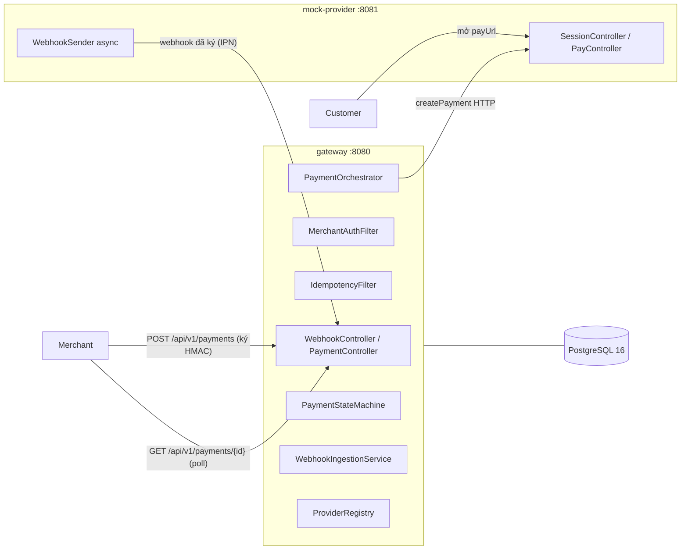
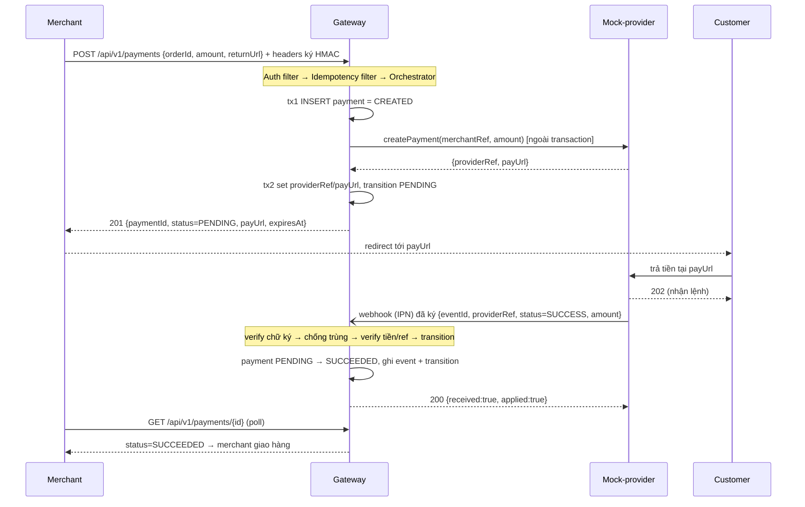
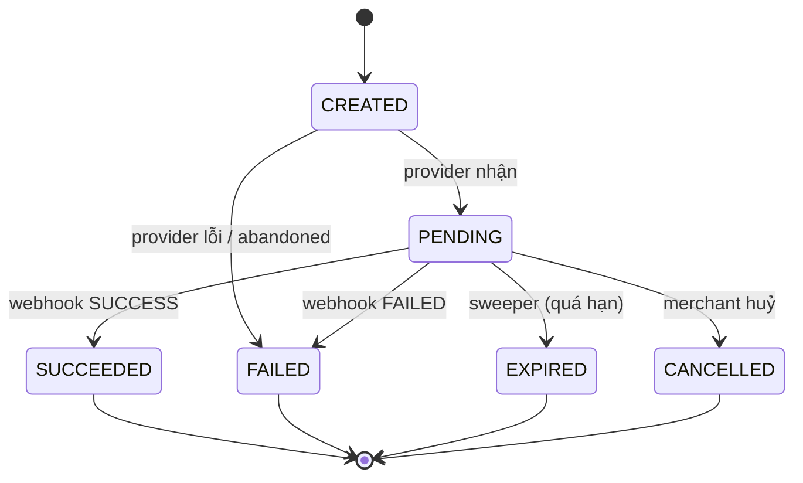
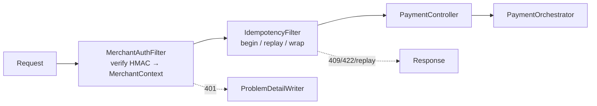

# Flux-pay — Kiến trúc & Thiết kế tổng thể (Increment 1)

> Tài liệu "cái nhìn tổng thể" cho mini payment gateway. Mô tả **toàn bộ thiết kế increment 1** (6 phase), kèm luồng end-to-end, mô hình dữ liệu, và lý do từng quyết định. Đánh dấu rõ **cái gì đã build** vs **cái gì còn trong kế hoạch**.
>
> Nguồn sự thật của mọi quyết định: `plans/261106-2236-mini-payment-gateway-increment-1-core-lifecycle/` và brainstorm report trong `plans/reports/`. Ghi chú học tập chi tiết từng chủ đề: `docs/learning/`.

## 1. Mục đích & phạm vi

Flux-pay là **mini payment gateway kiểu VNPAY/MoMo**, backend-only, dựng theo kiểu **learning-first** (mỗi phase: tái hiện lỗi trước → giải thích khái niệm → sửa → tự kiểm chứng).

**Increment 1 = lõi đồng bộ (synchronous core):** vòng đời payment, trừu tượng hoá provider, mock provider, webhook + chống trùng, HMAC auth cho merchant, idempotency.

**KHÔNG thuộc increment 1** (để các increment sau): tối ưu concurrency/DB locking, Kafka/async messaging, resilience, đối soát (reconciliation), gateway chủ động đẩy webhook về merchant.

## 2. Các actor

| Actor | Vai trò |
|---|---|
| **Customer** | Người mua. Bấm thanh toán, được redirect sang provider để trả tiền. |
| **Merchant** | Người bán. Có `api_key` + `secret`. Gọi gateway để tạo payment, rồi **pull** kết quả. Không giữ tiền, không giữ thông tin thẻ. |
| **Gateway (Flux-pay)** | Đứng giữa: điều phối + ghi nhận. Sở hữu state machine của payment và sổ cái sự kiện. **Không trừ tiền.** |
| **Provider / Bank** | Nơi tiền thực sự chuyển. Trong dự án là `mock-provider` (VNPAY giả). |

## 3. Bản đồ thành phần

Hai process Spring Boot 4.1 (Java 21) + PostgreSQL 16.



Package trong gateway (`com.fluxpay.gateway`): `common`, `merchant`, `payment`, `provider`, `webhook`, `idempotency`. Mock-provider: `com.fluxpay.mockprovider`.

**Nguyên tắc cố ý:** không front-load cấu trúc. Phase 1 chỉ có `common` + bảng `merchants`; mỗi package xuất hiện đúng phase của nó.

## 4. Luồng end-to-end (happy path)

Tạo → trả tiền trên provider → webhook → SUCCEEDED → merchant đọc kết quả.



**Hai điểm mấu chốt về đúng đắn:**
1. Sự thật đến từ **webhook server-to-server** (PUSH), không phải redirect trình duyệt (vốn chạy trên máy customer, không tin được).
2. Merchant biết kết quả bằng cách **tự gọi `GET` (PULL)**. Increment 1 chưa có gateway đẩy ngược về merchant. `returnUrl` chỉ để redirect trình duyệt cho đẹp.

## 5. Mô hình dữ liệu

Flyway quản lý schema (SQL thuần), `ddl-auto=validate` bắt lỗi lệch entity.

| Bảng | Migration | Vai trò |
|---|---|---|
| `merchants` | V1, V2 (seed), V5 (mã hoá secret) | Client của gateway. `api_key` = `X-Merchant-Id`. `secret` cho HMAC. |
| `payments` | V3, V7 (unique index) | Thực thể trung tâm. Có `@Version` (cho increment 2), `providerRef`, `payUrl`, `expiresAt`. |
| `payment_transitions` | V3 | Sổ cái chuyển trạng thái (audit). `source` = MERCHANT/PROVIDER/SYSTEM. |
| `webhook_events` | V4 | Sổ cái sự kiện webhook. Unique `(provider_code, event_id)` + `duplicate_count`. |
| `idempotency_keys` | V6 | Lưu response lần đầu để replay. PK `(merchant_id, idem_key)`. |

`V7` là **partial unique index** chỉ trên payment còn sống:
```sql
CREATE UNIQUE INDEX ux_payments_live_order ON payments (merchant_id, order_id)
  WHERE status IN ('CREATED','PENDING','SUCCEEDED');
```
Cố ý: đơn FAILED/EXPIRED/CANCELLED vẫn được tạo lại.

## 6. State machine của payment



| Từ | Được phép sang |
|---|---|
| CREATED | PENDING, FAILED |
| PENDING | SUCCEEDED, FAILED, EXPIRED, CANCELLED |
| SUCCEEDED / FAILED / EXPIRED / CANCELLED | (terminal, không đi đâu) |

**Luật bất biến:** mọi thay đổi trạng thái đi qua **đúng một** method `transition(payment, to, reasonCode, source)`. Nó ném `IllegalPaymentTransitionException` (409) nếu bước chuyển phi pháp, và ghi một dòng `payment_transitions` khi thành công. `reasonCode` là token ổn định (`PROVIDER_ACCEPTED`, `MERCHANT_CANCEL`, `EXPIRED_BY_SWEEPER`...), không phải free text. Nhờ luật này, webhook SUCCESS đến trễ sau khi đã EXPIRED bị từ chối, **không ghi đè**.

## 7. Hợp đồng API

Gateway, mọi `/api/**` cần 3 header: `X-Merchant-Id`, `X-Timestamp`, `X-Signature` (từ phase 5).

| Method + Path | Vào | Ra | Ghi chú |
|---|---|---|---|
| `POST /api/v1/payments` | `{orderId, amount, description, returnUrl, provider?}` + `Idempotency-Key` | 201 `{paymentId, status, payUrl, expiresAt}` | Tạo payment. |
| `GET /api/v1/payments/{id}` | — | payment + transitions | Scope theo merchant; id người khác → 404. |
| `POST /api/v1/payments/{id}/cancel` | — | CANCELLED | Chỉ từ PENDING, else 409. |
| `POST /webhooks/{providerCode}` | raw body đã ký | 200 `{received, duplicate, applied, rejectReason?}` | Provider gọi. Không auth merchant. |
| `GET /actuator/health` | — | `{status:UP}` | Không auth. |

Mọi lỗi trả **RFC 7807 problem detail** có field `code` ổn định (ví dụ `PAYMENT_NOT_FOUND`, `AUTH_BAD_SIGNATURE`). Viết bởi `ProblemDetailWriter` dùng chung cho cả controller advice lẫn filter.

## 8. Các mối quan tâm chéo (thiết kế chi tiết)

### 8.1. Trừu tượng hoá provider (phase 3)

`PaymentProvider` (interface, Strategy) + `MockProviderAdapter` (Adapter, gọi HTTP) + `ProviderRegistry` (Factory, resolve theo code). **Payment core không phụ thuộc compile-time vào adapter cụ thể** — thêm provider mới = một class + config.

`PaymentOrchestrator.create()` **không** `@Transactional`, mà dùng `TransactionTemplate`:
```
tx1: INSERT CREATED (commit)
     provider.createPayment(...)   ← KHÔNG có transaction khi gọi HTTP
tx2: set providerRef/payUrl, transition PENDING
lỗi provider → tx: transition FAILED (PROVIDER_UNAVAILABLE) → 502
lỗi khác    → tx: transition FAILED (INTERNAL_ERROR) → 500
```
**Vì sao:** gọi mạng bên trong một DB transaction sẽ giữ connection suốt thời gian HTTP timeout (nút thắt increment 2 sẽ đo). Và một `@Transactional` tự gọi trên cùng bean sẽ âm thầm gộp hai transaction làm một. Sweeper còn fail các dòng CREATED quá cũ (`CREATE_ABANDONED`) để dọn trường hợp JVM chết giữa hai transaction.

### 8.2. Nhận webhook (phase 4)

Provider giao webhook **ít nhất một lần** (at-least-once) → gateway phải chịu trùng, trễ, giả mạo. `WebhookIngestionService` **không** `@Transactional`, chạy ba `TransactionTemplate` tách biệt:

```
1. verify chữ ký (no tx) → 401 nếu sai. Parse.
2. tx A: INSERT event ON CONFLICT (provider_code, event_id) DO NOTHING RETURNING id
         không có id → trùng → tx A': duplicate_count++ → 200 {duplicate:true}
3. tx B: load payment; check tồn tại / ref / amount; transition(SUCCEEDED|FAILED)
4. tx C: update event = APPLIED hoặc REJECTED + reason
```

**Bốn phòng thủ:**
- **Chống trùng bằng ràng buộc DB**, không exists-check (race-safe). Đúng 1 dòng/sự kiện, đúng 1 transition.
- **Luôn trả 200 cho từ chối nghiệp vụ** (lưu REJECTED + reason). Chỉ 401/404/413 cho lỗi hạ tầng, **trước khi ghi gì**. Lý do: provider coi non-200 là "chưa nhận" và retry hàng giờ.
- **Chữ ký trên raw bytes** → controller đọc `byte[]`, không `@RequestBody` DTO (parse lại làm vỡ chữ ký).
- **Verify giá trị**: tồn tại → đúng ref → đúng tiền → đúng luật state machine.

**Vì sao ba transaction, không một:** unique violation làm abort cả transaction Postgres; runtime exception băng qua `@Transactional` đánh dấu rollback-only → "catch rồi đi tiếp" trong một tx sẽ commit được gì cả.

### 8.3. HMAC auth cho merchant (phase 5)

`MerchantAuthFilter` (`OncePerRequestFilter`, không dùng Spring Security — rõ ràng hơn để học). Chữ ký trên canonical string:
```
METHOD \n PATH \n X-Timestamp \n Idempotency-Key \n sha256hex(body)
X-Signature = lowercasehex(HMAC-SHA256(secret, canonical))
```
Thứ tự check (fail-closed): body cap 64KB → đủ header → tìm merchant theo api key → active → cửa sổ thời gian (|now-ts| ≤ 5 phút, chặn replay) → giải mã secret → so chữ ký (constant-time).

Secret lưu mã hoá **AES-256-GCM** (`v1:` + base64(iv‖ciphertext‖tag)), IV ngẫu nhiên mỗi lần, AAD = api key, key từ env `FLUXPAY_SECRET_KEY`. App **fail-fast** lúc khởi động nếu key sai hoặc secret DEMO không giải mã được.

### 8.4. Idempotency (phase 6)

`IdempotencyFilter` (sau `MerchantAuthFilter`) trên `POST /api/v1/payments`. `Idempotency-Key` bắt buộc.

```
begin(merchant, key, bodyHash):
  INSERT ON CONFLICT DO NOTHING RETURNING → thắng = NEW
  thua → đọc row:
    COMPLETED → REPLAY (trả lại status+body cũ, header Idempotency-Replayed:true)
    IN_PROGRESS lease còn hạn → 409
    IN_PROGRESS lease hết hạn → UPDATE có điều kiện (take-over) → NEW / 409
    hash khác → 422 (dùng lại key cho body khác)
```
NEW → bọc response bằng `ContentCachingResponseWrapper`, chạy tiếp, rồi nếu status thuộc tập lưu (201,400,404,409,422,502) → `complete`; else (500,503) → `abandon` (xoá để retry được).

**Vì sao filter, không code trong controller:** response lỗi (502, 409) do `ProblemDetailsHandler` render **sau khi** controller mất quyền; chỉ response wrapper thấy status+body cuối cùng. Replay **không** chạm controller → không gọi provider lần hai.

**Hai lớp bảo vệ:** `Idempotency-Key` (chống retry cùng request) + partial unique index trên `order_id` (chống trùng đơn bằng key khác). Đơn FAILED vẫn tạo lại được.

## 9. Chuỗi filter trên `/api/**`


`/webhooks/**` và `/actuator/health` **không** qua auth filter (webhook dùng chữ ký provider riêng).

## 10. Chiến lược transaction (tóm tắt)

| Chỗ | Cách | Vì sao |
|---|---|---|
| Orchestration nhiều bước (create, webhook) | `TransactionTemplate`, nhiều tx | Gọi mạng ngoài tx; cô lập rollback từng bước; tránh proxy gộp tx |
| Service một bước đơn giản | `@Transactional` | Đủ dùng, đơn giản |
| Clock | bean `Clock` (test thay bằng `MutableClock`) | Đẩy payment quá hạn mà không cần sleep |

## 11. Trạng thái build theo phase

| Phase | Nội dung | Trạng thái |
|---|---|---|
| 1 | Bộ khung: 2 app, Postgres, Flyway, health, Testcontainers | **Done** (2026-11-06) |
| 2 | Payment + state machine + sweeper hết hạn | **Done** (2026-11-07) |
| 3 | Provider interface + mock provider (createPayment) | **Done** (2026-11-07) |
| 4 | Webhook (IPN) + chống trùng | **Done** (2026-11-07) |
| 5 | HMAC auth merchant | Kế hoạch |
| 6 | Idempotency | Kế hoạch |

Strictly sequential: mỗi phase phụ thuộc phase trước.

## 12. Những gì hoãn (increment sau)

- **Increment 2:** concurrency hardening (lock + re-read khi webhook tới lúc payment còn CREATED), webhook out-of-order, retry simulation, đo nút thắt connection pool.
- **Increment 3:** Kafka / async messaging.
- **Increment 4:** resilience, **reconciliation** (xử lý tiền "lơ lửng" khi webhook SUCCESS tới sau EXPIRED), `queryStatus` chủ động hỏi provider.
- **Chưa có trong roadmap 6 phase:** gateway chủ động **đẩy webhook về merchant** (merchant callback) — đối xứng với phase 4, sẽ tái dùng `HmacSigner` + event ledger.

## 13. Chạy & kiểm thử

```bash
docker compose up --build        # postgres + gateway(8080) + mock-provider(8081)
curl localhost:8080/actuator/health
curl localhost:8081/actuator/health
./mvnw verify                    # Testcontainers (cần Docker)
```
Postman: import `postman/flux-pay.postman_collection.json` + environment. Boot 4 đổi tên starter so với Boot 3 — xem bảng trong `README.md`.

## 14. Câu hỏi mở

- **Gateway → merchant callback**: increment 1 chỉ cho merchant pull. Có muốn đưa "gateway đẩy webhook về merchant" thành một increment riêng không, hay chấp nhận pull là đủ cho mục tiêu học?
